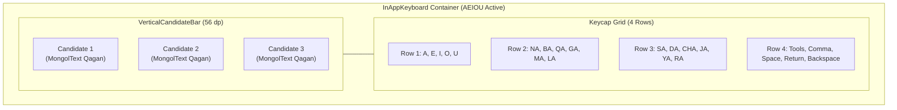

# Technical Design Document: Legacy Android UI & Behavioral Dynamics Alignment

* **Author:** suragch
* **Status:** Ready for Implementation
* **Date:** 2026-11-04

---

## Overview

Chimee provides Traditional Mongolian vertical text editing, image card composition, and virtual keyboard input. While the initial Flutter port established single-process SQLite persistence and robust Menksoft-Unicode encoding conversions, its presentation layer diverged from the legacy Android app's UI geometry and interaction dynamics.

This project re-architects the presentation layer of Chimee Flutter to match the visual ergonomics, layout algorithms, and navigation hierarchy of the original Android app. It replaces the full-width static editor with a centered, content-driven floating card governed by a discrete 50 dp height auto-sizing algorithm, realigns the virtual keyboard with upright vertical letterforms and a left-docked candidate bar, integrates native vertical menus using the `mongol` package, and restores strict monolingual Mongolian localization across all primary and secondary workflows.

---

## The Problem

Traditional Mongolian is written vertically from top to bottom, with lines wrapping from left to right. This vertical-first flow imposes specific layout and ergonomic requirements that standard horizontal Material Design conventions break:

1. **Card Proportions and Container Geometry**:
   The current Flutter implementation places the editor in an edge-to-edge container (`width: double.infinity`) fixed at a static height. In the legacy Android app, the input window is a centered floating card that wraps tightly around content with a minimum 2:1 height-to-width proportion (height is at least double the width). Stretching the editor across the screen eliminates the paper-like canvas aesthetic and makes column wrapping unnatural.
2. **Absence of Content-Driven Discrete Sizing**:
   The legacy Android app used a dynamic sizing algorithm that evaluated text wrapping in discrete 50 dp height increments. As text accumulated, the card expanded vertically in 50 dp steps to fit longer columns, preventing premature column wrapping. If text was short, height decreased in 50 dp steps to avoid wasting vertical space. Without this algorithm, the Flutter port either leaves massive empty whitespace or forces users to manually adjust heights.
3. **Ergonomic Mismatch in Virtual Keyboards**:
   - **Rotated Keycap Glyphs**: In standard Flutter `Text` widgets, Traditional Mongolian glyphs render along horizontal baselines, causing letters to appear rotated 90 degrees counter-clockwise (sideways). Users are forced to mentally rotate characters while typing.
   - **Horizontal Candidate Bar on Vertical Script**: The current port displays predictive word completions in a horizontal bar above the keyboard. Because Mongolian words flow top-to-bottom, arranging vertical words horizontally forces unnatural reading gymnastics.
4. **Cultural and Contextual Disruption via English and Horizontal Menus**:
   The current port crowded bilingual menu items (e.g., `ᠬᠠᠳᠠᠭᠠᠯᠠᠬᠤ (Save Favorite)`) into standard horizontal Material drop-down menus in the top AppBar. The legacy Android app maintained vertical menus rendered exclusively in Traditional Mongolian using the `Qagan` font, with formatting options (Color and Font) housed directly inside the text selection context menu.

---

## Goals

- **Content-Driven Floating Card**: Render the editor as a centered floating card with 2 dp elevation over a `#E4E4E4` background canvas, occupying the upper stage in phone portrait mode.
- **50 dp Step Auto-Sizing Algorithm**: Implement the discrete 50 dp height stepping algorithm driven by an off-screen `MongolTextPainter` layout pass, enforcing a minimum height of 150 dp and a minimum 2:1 height-to-width proportion (card height $\ge 2 \times \text{width}$).
- **Upright Keyboard Keycaps**: Render all Traditional Mongolian virtual keyboard keycaps in their natural upright vertical orientation using the `Qagan` font via `RotatedBox(quarterTurns: 1)`.
- **Vertical AEIOU Candidate Bar**: Position word completion candidates in a dedicated vertical strip docked along the left edge of the AEIOU layout, matching top-to-bottom reading direction.
- **Floating Keyboard Restore Button**: Display a floating circular keyboard icon button (48x48 dp, 50% opacity) in the bottom-right of the canvas when the virtual keyboard is hidden, allowing immediate restoration.
- **Vertical Qagan Menus**: Implement vertical popup menus using `MongolPopupMenuButton` and `showMongolMenu` from the `mongol` package for all top-level and contextual actions.
- **Selection-Based Contextual Styling**: Move Font and Color pickers into the text selection context menu (`MongolAdaptiveTextSelectionToolbar`), restoring top AppBar minimalism (Share, Photo, Favorites, Overflow).
- **Pure Monolingual Localization**: Eliminate all English labels and bilingual parentheticals across primary and secondary workflows, adhering strictly to verbatim legacy Android `strings.xml`.
- **Form Factor Adaptation**: Enforce portrait orientation lock on phone-sized devices while supporting dynamic orientation on tablets, maintaining intrinsic keyboard touch targets without viewport overflow.

---

## Non-Goals

- Modifying the underlying SQLite schema (`chimee_flutter.db`) or legacy migration engine (`LegacyMigrator`).
- Altering the runtime codec layer (`mongol_code` Unicode-Menksoft conversions).
- Implementing an OS system-level input method (`InputMethodService` or iOS keyboard extension); the keyboard remains strictly in-app.
- Modifying the source code of the external `mongol` package.
- Introducing new features, translation strings, or UI options not present in the legacy Android application.
- Keyboard Emoji View (omitted from this UI alignment release; dedicated emoji glyph rendering and asset catalogs will be addressed in a future update).

---

## Technical Plan (Architecture)

### 1. Architectural Overview & Component Decomposition

The redesigned presentation layer decouples screen layout, card sizing, keyboard orchestration, and text manipulation into modular subsystems:

```mermaid
flowchart TD
    subgraph Viewport ["Viewport Coordinator (EditorScreen)"]
        TopCanvas["EditorCanvasStage\n(Flexible Upper Stage, Background: #E4E4E4)"]
        KBHost["KeyboardHostStage\n(Intrinsic Lower Stage, Background: #DEDEDE)"]
        RestoreBtn["FloatingRestoreKeyboardButton\n(Bottom-Right, 48x48 dp, alpha 0.5)"]
    end

    subgraph CardEngine ["Floating Card Engine"]
        AutoSizer["CardAutoSizer\n(Off-Screen MongolTextPainter Pass)"]
        AnimCard["FloatingEditorCard\n(150ms ease-out Size Transition)"]
        ScrollEditor["Horizontal Scroll Container\n(SingleChildScrollView Axis.horizontal)"]
        TextField["MongolTextField\n(Vertical Text Flow, Qagan Font)"]
    end

    subgraph KeyboardSystem ["In-App Keyboard Subsystem"]
        KBCoordinator["InAppKeyboard Coordinator"]
        AEIOUData["AeiouLayout (Data Model)"]
        VertCandidates["VerticalCandidateBar\n(Left Docked, 56 dp)"]
        OtherLayouts["Qwerty, Cyrillic, English Layouts"]
        KeycapRenderer["KeyboardKeyButton\n(Upright RotatedBox Qagan)"]
        KBTools["Tool Buttons:\nDismiss, Navigation View"]
    end

    subgraph MenusAndActions ["Vertical Menus & Actions"]
        TopBar["AppBar (4 Actions):\nShare, Photo, Star, Overflow"]
        ShareMenu["Vertical MongolMenu:\nWeChat, Bainu, More"]
        OverflowMenu["Vertical MongolMenu:\nOpen / Save (Dirty Tracked), Settings"]
        ContextMenu["MongolAdaptiveTextSelectionToolbar:\nCopy, Cut, Paste, Select All, Color, Font"]
    end

    %% Wiring
    TopCanvas --> AnimCard
    TopCanvas --> RestoreBtn
    AnimCard --> ScrollEditor --> TextField
    TextField -.->|Text Change / Style| AutoSizer
    AutoSizer -.->|Size(w, h)| AnimCard

    KBHost --> KBCoordinator
    KBCoordinator --> AEIOUData
    KBCoordinator --> VertCandidates
    KBCoordinator --> KeycapRenderer
    KBCoordinator --> OtherLayouts
    KBCoordinator --> KBTools

    TopBar --> ShareMenu
    TopBar --> OverflowMenu
    TextField --> ContextMenu
```

---

### 2. Viewport Partitioning & Coordinator Lifecycle

The viewport coordinator organizes the screen space based on orientation, device class, and keyboard visibility:

- **Intrinsic Viewport Partitioning**:
  - Rather than applying rigid fractional flex weights (`flex: 6` / `flex: 4`) that cause `RenderFlex` overflows on compact viewports (such as iPhone SE with 580 dp total height), the layout uses intrinsic keyboard sizing:
    - Lower stage: `KeyboardHostStage` sizes to its intrinsic ergonomic height (`mainAxisSize: MainAxisSize.min`), requiring ~240 dp for 4 key rows and candidate strips.
    - Upper stage: `Expanded(child: EditorCanvasStage)` flexibly consumes all remaining vertical viewport space.
    - On standard phone viewports (e.g. 800+ dp height), this intrinsically produces the ~60/40 visual balance of the original Android app while guaranteeing that keyboard touch targets never compress or overflow.
  - When `_isKeyboardVisible` is `false`:
    - Lower stage collapses completely.
    - Upper stage expands to occupy 100% of the body space with the card remaining centered.
    - A floating action button (`FloatingRestoreKeyboardButton`) renders in the bottom-right corner with 16 dp margins, 48x48 dp dimensions, 50% opacity, and `Icons.keyboard_outlined`.
- **Landscape Tablet Bounds**:
  - On tablets in landscape orientation, the keyboard host is constrained to a maximum width of 800 dp via `Center(child: ConstrainedBox(constraints: BoxConstraints(maxWidth: 800), child: ...))`, preventing keycaps from stretching unnaturally wide across the screen.
- **Orientation & Lifecycle Management**:
  - To prevent Flutter framework exceptions (`dependOnInheritedWidgetOfExactType<MediaQuery>() was called before initState() completed`), orientation checks are performed inside `didChangeDependencies()`:
    ```dart
    @override
    void didChangeDependencies() {
      super.didChangeDependencies();
      final shortestSide = MediaQuery.sizeOf(context).shortestSide;
      if (shortestSide < 600) {
        SystemChrome.setPreferredOrientations([
          DeviceOrientation.portraitUp,
          DeviceOrientation.portraitDown,
        ]);
      } else {
        SystemChrome.setPreferredOrientations([
          DeviceOrientation.portraitUp,
          DeviceOrientation.portraitDown,
          DeviceOrientation.landscapeLeft,
          DeviceOrientation.landscapeRight,
        ]);
      }
    }
    ```
  - In `dispose()`, full device orientation freedom is restored:
    ```dart
    @override
    void dispose() {
      SystemChrome.setPreferredOrientations([
        DeviceOrientation.portraitUp,
        DeviceOrientation.portraitDown,
        DeviceOrientation.landscapeLeft,
        DeviceOrientation.landscapeRight,
      ]);
      super.dispose();
    }
    ```

---

### 3. Floating Input Card & `CardAutoSizer` Engine

#### 3.1 Architectural Sizing Contract
Vertical Mongolian text runs downwards in lines, and new lines wrap from left to right. Therefore, increasing the container height allows each vertical column to accommodate more characters before requiring a new column, which directly limits horizontal width expansion.

`CardAutoSizer` is an isolated, deterministic calculation service decoupled from the live widget tree:
- **Inputs**:
  - `text` (String): Raw text currently composed in the editor.
  - `textStyle` (TextStyle): Font family, font size, and text metrics.
  - `maxViewportHeight` (double): Upper canvas boundary available for the card.
  - `maxViewportWidth` (double): Viewport width available for the card.
  - `currentHeight` (double): The card's existing height before the layout pass.
  - `isManualScaling` (bool): Whether the user is actively engaged in a 2-pointer pinch gesture.
  - `manualDesiredHeight` (double?): User-specified height override during manual scaling.
- **Outputs**: `Size(width, height)` representing the target card boundaries.
- **Invariants & Sizing Rules**:
  - Minimum height: `minHeight = 150.0`.
  - Height step increment: `heightStep = 50.0`.
  - Minimum height-to-width proportion: `minHeightToWidthProportion = 2.0` (height $\ge 2 \times \text{width}$; width is at least 75 dp, but no more than $h / 2$ unless required by unconstrained line wrapping).
  - Absolute minimum width: `absoluteMinWidth = minHeight / minHeightToWidthProportion` (75.0 dp).
  - Maximum card width: `maxCardWidth = max(absoluteMinWidth, maxViewportWidth - 32.0)`.
  - Clamping boundary safety: Whenever clamping width, the lower bound is guarded by `effectiveMinW = min(minW, maxCardWidth)` to avoid `ArgumentError` crashes on compact or landscape viewports.

#### 3.2 Reference Algorithm Implementation

```dart
class CardAutoSizer {
  static const double minHeight = 150.0;
  static const double heightStep = 50.0;
  static const double minHeightToWidthProportion = 2.0; // 2:1 height-to-width ratio
  static const EdgeInsets cardPadding = EdgeInsets.all(16.0);

  /// Computes the exact target size for the floating editor card.
  static Size computeSize({
    required String text,
    required TextStyle textStyle,
    required double maxViewportHeight,
    required double maxViewportWidth,
    required double currentHeight,
    required bool isManualScaling,
    double? manualDesiredHeight,
  }) {
    final double maxCardHeight = max(minHeight, maxViewportHeight);
    final double absoluteMinWidth = minHeight / minHeightToWidthProportion; // 75 dp
    final double maxCardWidth = max(absoluteMinWidth, maxViewportWidth - 32.0); // 16 dp padding each side

    // 1. Manual pinch-to-scale sizing path
    if (isManualScaling && manualDesiredHeight != null) {
      final double clampedH = manualDesiredHeight.clamp(minHeight, maxCardHeight);
      final double measuredW = _measureWidth(text, textStyle, clampedH) + cardPadding.horizontal;
      double targetW = max(measuredW, absoluteMinWidth);
      if (minHeightToWidthProportion * targetW < clampedH) {
        targetW = clampedH / minHeightToWidthProportion;
      }
      final double effectiveMinW = min(absoluteMinWidth, maxCardWidth);
      return Size(targetW.clamp(effectiveMinW, maxCardWidth), clampedH);
    }

    // 2. Auto-sizing path: Start from current height bounded to min/max
    double h = max(currentHeight, minHeight).clamp(minHeight, maxCardHeight);
    double w = _measureWidth(text, textStyle, h) + cardPadding.horizontal;
    final double minW = absoluteMinWidth; // 75 dp base width

    if (w < minW) {
      w = minW;
    }

    // Increment height in 50 dp steps if width exceeds height
    if (h < w && h < maxCardHeight) {
      while (h < maxCardHeight) {
        h += heightStep;
        if (h >= maxCardHeight) {
          h = maxCardHeight;
          w = _measureWidth(text, textStyle, h) + cardPadding.horizontal;
          break;
        }
        w = _measureWidth(text, textStyle, h) + cardPadding.horizontal;
        if (h >= w) {
          break;
        }
      }
    }
    // Decrement height in 50 dp steps if height is disproportionately tall
    else if (h > minHeightToWidthProportion * w && h > minHeight) {
      while (h > minHeight) {
        h -= heightStep;
        if (h <= minHeight) {
          h = minHeight;
          w = _measureWidth(text, textStyle, h) + cardPadding.horizontal;
          break;
        }
        w = _measureWidth(text, textStyle, h) + cardPadding.horizontal;
        if (h <= minHeightToWidthProportion * w) {
          break;
        }
      }
    }

    if (w < minW) {
      w = minW;
    }

    final double effectiveMinW = min(minW, maxCardWidth);
    final double finalW = w.clamp(effectiveMinW, maxCardWidth);
    return Size(finalW, h);
  }

  static double _measureWidth(String text, TextStyle style, double availableHeight) {
    if (text.isEmpty) return 0.0;
    final textSpan = TextSpan(text: text, style: style);
    final painter = MongolTextPainter(text: textSpan);
    final double contentHeight = max(10.0, availableHeight - cardPadding.vertical);
    painter.layout(minHeight: 0.0, maxHeight: contentHeight);
    return painter.width;
  }
}
```

#### 3.3 Visual Presentation & Horizontal Column Overflow
- The computed `Size(w, h)` is bound to `FloatingEditorCard` using an `AnimatedContainer` (duration: 150 ms, curve: `Curves.easeOutCubic`) centered inside `EditorCanvasStage`.
- Visual styling:
  - Color: Selected background color (default `#FFFFFF` or parchment `#FBF6EC`).
  - Shape: Rounded rectangle (`BorderRadius.circular(4.0)`).
  - Elevation: 2 dp subtle drop shadow (`BoxShadow(color: Colors.black12, blurRadius: 4.0, offset: Offset(0, 2))`).
  - Interior: `SingleChildScrollView(scrollDirection: Axis.horizontal)` hosting `MongolTextField(expands: true, maxLines: null)`. When text volume exceeds `maxCardWidth`, the inner scroll view enables smooth horizontal scrolling through columns without clipping or breaking card boundaries.

#### 3.4 Gesture Arbitration Precedence
To prevent touch gesture contention between canvas scaling, card scrolling, and text editing, `ScaleGestureContainer` enforces explicit priority:
1. **Single-Pointer Tap & Long-Press**: Directly routed to `MongolTextField` to support cursor placement, word selection, and contextual text selection toolbar presentation.
2. **Single-Pointer Drag / Scroll**: Captured for horizontal card scrolling only when displacement exceeds `kTouchSlop` (18 dp), avoiding inadvertent scrolling during taps.
3. **Two-Pointer Pinch**: Disambiguated by `ScaleGestureRecognizer`:
   - Vertical spread (`spanY > spanX`): Modifies manual card height (`manualDesiredHeight = h_initial * scaleFactor`).
   - Horizontal spread (`spanX >= spanY`): Modifies font size (`fontSize = fontSize_initial * scaleFactor`).
   - Gesture Release (`onScaleEnd`): Manual mode disengages and auto-sizing snaps the card to the nearest valid discrete 50 dp step baseline.

---

### 4. Virtual Keyboard Subsystem



#### 4.1 Upright Letterform Typography on Keycaps
- Standard `Text` widgets render Mongolian characters sideways on horizontal baselines.
- To display upright vertical letters, `KeyboardKeyButton` wraps letter glyphs in `RotatedBox(quarterTurns: 1)` with `Text(label, style: TextStyle(fontFamily: 'Qagan'))`.
- Action keys (Backspace, Shift, Return, Space, LayoutPicker, Navigation) render standard unrotated Material icons or system labels.
- Keycap dimensions dynamically protect typography: glyph labels are wrapped in `FittedBox(fit: BoxFit.scaleDown)` to guarantee characters never exceed 75% of keycap boundaries.

#### 4.2 AEIOU Vertical Candidate Strip
- In `InAppKeyboard`, when the active layout is `AeiouLayout`, a dedicated 56 dp wide `VerticalCandidateBar` is docked along the left edge of the keyboard container in a `Row` alongside the keycap grid.
- `AeiouLayout` remains a pure static data class holding key definitions.
- Word candidates are rendered in a vertical `ListView.separated` scrolling vertically, displaying suggestions as vertical words via `MongolText` with `fontFamily: 'Qagan'`.
- When candidates are empty, `VerticalCandidateBar` retains its 56 dp column width with a clean background to prevent jarring layout shifts.
- QWERTY maintains a horizontal candidate bar across the top.
- Cyrillic and English layouts disable candidate presentation.

#### 4.3 Utility Views & Cursor Navigation Mechanics
The keyboard toolbar provides two utility triggers (with Emoji View explicitly deferred as a Non-Goal):
1. **Dismiss Keyboard**: Immediately collapses the keyboard container and exposes the floating restore button.
2. **Navigation View (`KeyboardNavigationView`)**:
   - Replaces keycaps with a directional keypad view (Left, Right, Up, Down, Line Start, Line End).
   - Vertical Script Cursor Mechanics:
     - **Up Arrow**: Decrements cursor index by 1 (`offset = max(0, offset - 1)`), moving the cursor upward within the current vertical column.
     - **Down Arrow**: Increments cursor index by 1 (`offset = min(text.length, offset + 1)`), moving the cursor downward within the current vertical column.
     - **Left Arrow**: Moves cursor one column to the left (previous column) by identifying the column boundary in `MongolTextPainter` line metrics or finding the previous newline.
     - **Right Arrow**: Moves cursor one column to the right (next column).
     - **Line Start**: Moves cursor to the top of the current column.
     - **Line End**: Moves cursor to the bottom of the current column.

---

### 5. Vertical Menus & Selection-Based Formatting

#### 5.1 Top AppBar Actions
The AppBar contains exactly 4 actions:
1. **Share (`Icons.share`)**:
   - Verifies platform URI schemes for WeChat (`weixin://`) and Bainu (`bainu://`) via `canLaunchUrl`.
   - If either app is installed, triggers `showMongolMenu` with vertical items:
     - `ᠸᠢᠴᠠᠲ` (WeChat)
     - `ᠪᠠᠢᠨᠠᠤ` (Bainu)
     - `ᠨᠡᠩ ᠣᠯᠠᠨ` (More - system share sheet)
   - If neither app is installed, immediately routes to system share via `Share.share(...)`.
2. **Photo Overlay (`Icons.insert_photo`)**:
   - Prompts image selection via `image_picker` and pushes `PhotoOverlayScreen` passing current editor text. If editor is empty, displays `alert_input_window_empty` (`ᠴᠢᠮᠡᠭᠡ ᠬᠣᠭᠣᠰᠣᠨ ᠪᠠᠢᠨ᠎ᠠ`).
3. **Favorites (`Icons.star`)**:
   - Opens `FavoritesScreen` displaying saved vertical messages.
4. **Overflow Menu (`Icons.more_vert`)**:
   - Maintains dirty tracking: `hasUnsavedContent = _textController.text.isNotEmpty && _textController.text != _lastSavedText`.
   - Triggers `showMongolMenu` displaying:
     - `ᠬᠠᠳᠠᠭᠠᠯᠠᠬᠤ` (Save) if `hasUnsavedContent` is true; `ᠨᠡᠭᠡᠭᠡᠬᠦ` (Open) if false.
     - `ᠳᠤᠬᠢᠷᠠᠭᠤᠯᠭ᠎ᠠ` (Settings).

#### 5.2 Contextual Text Selection Toolbar & Canvas Fallbacks
- In `MongolTextField`, `contextMenuBuilder` is wired to `MongolAdaptiveTextSelectionToolbar.buttonItems`.
- When text is selected, the menu displays vertical buttons:
  - Copy (`ᠬᠠᠭᠤᠯᠬᠤ`), Cut (`ᠣᠭᠲᠣᠯᠬᠤ`), Paste (`ᠨᠠᠭᠠᠬᠤ`), Select All (`ᠪᠦᠭᠦᠨ ᠢ ᠰᠤᠩᠭᠤᠬᠤ`).
  - `ᠥᠩᠭᠡ` (Color): Opens `ColorChooserDialog`.
  - `ᠦᠰᠦᠭ ᠤᠨ ᠲᠢᠭ` (Font): Opens `FontChooserDialog`.
- **Canvas Styling Fallback When Empty**: When the editor contains no text (or has no active selection), long-pressing the canvas background or accessing Settings provides direct entry to `ColorChooserDialog` (background canvas color) and `FontChooserDialog`.

#### 5.3 External Destinations & Payloads
- **Settings Help**: Launches `http://www.studymongolian.net/apps/chimee/zh/chimee-help/` via `url_launcher`.
- **About Contact**: Launches `http://www.studymongolian.net/contact-zh/` via `url_launcher`.
- **About Updates**: Launches `http://www.studymongolian.net/apps/chimee/zh/` via `url_launcher`.
- **About Share App**: Invokes `Share.share('$appName $appVersion\nhttp://www.studymongolian.net/apps/chimee/zh/')`.

---

### 6. Monolingual Localization Architecture

All user-visible strings are centralized in `lib/core/localization/mongol_strings.dart` and match legacy Android `strings.xml` verbatim:

```dart
class MongolStrings {
  // Navigation & Menus
  static const String shareWeChat = 'ᠸᠢᠴᠠᠲ';
  static const String shareBainu = 'ᠪᠠᠢᠨᠠᠤ';
  static const String shareOther = 'ᠨᠡᠩ ᠣᠯᠠᠨ';
  static const String open = 'ᠨᠡᠭᠡᠭᠡᠬᠦ';
  static const String save = 'ᠬᠠᠳᠠᠭᠠᠯᠠᠬᠤ';
  static const String settings = 'ᠳᠤᠬᠢᠷᠠᠭᠤᠯᠭ᠎ᠠ';
  static const String color = 'ᠥᠩᠭᠡ';
  static const String font = 'ᠦᠰᠦᠭ ᠤᠨ ᠲᠢᠭ';
  static const String copy = 'ᠬᠠᠭᠤᠯᠬᠤ';
  static const String cut = 'ᠣᠭᠲᠣᠯᠬᠤ';
  static const String paste = 'ᠨᠠᠭᠠᠬᠤ';
  static const String selectAll = 'ᠪᠦᠭᠦᠨ ᠢ ᠰᠤᠩᠭᠤᠬᠤ';

  // Dialog Controls & Labels
  static const String ok = 'ᠪᠣᠯᠣᠨ᠎ᠠ';
  static const String cancel = 'ᠦᠭᠡᠢ';
  static const String gotIt = 'ᠮᠡᠳᠡᠯ᠎ᠡ';
  static const String background = 'ᠰᠠᠭᠤᠷᠢ';
  static const String textColor = 'ᠦᠭᠡ';
  static const String fileName = 'ᠬᠠᠳᠠᠭᠠᠯᠠᠬᠤ ᠨᠡᠷ᠎ᠡ';
  static const String emptyMessage = 'ᠴᠢᠮᠡᠭᠡ ᠬᠣᠭᠣᠰᠣᠨ ᠪᠠᠢᠨ᠎ᠠ';
  static const String saveSuccess = 'ᠠᠮᠵᠢᠯᠲᠠ‪ᠲᠠᠢ ᠬᠠᠳᠠᠭᠠᠯᠠᠪᠠ';

  // Secondary Features & About
  static const String history = 'ᠶᠠᠪᠤᠭᠤᠯᠵᠤ ᠦᠩᠭᠡᠷᠡᠭᠰᠡᠨ ᠴᠢᠮᠡᠭᠡ';
  static const String codeConverter = 'ᠺᠤᠳ᠋ ᠰᠣᠯᠢᠬᠤ';
  static const String about = 'ᠮᠠᠨ ᠤ ᠲᠤᠬᠠᠢ';
  static const String help = 'ᠬᠠᠪᠰᠤᠷᠤᠮᠵᠢ';
  static const String edit = 'ᠨᠠᠢᠷᠠᠭᠤᠯᠬᠤ';
  static const String delete = 'ᠤᠰᠠᠳᠬᠠᠬᠤ';
  static const String add = 'ᠨᠡᠮᠡᠬᠦ';
  static const String clearAll = 'ᠪᠦᠭᠦᠨ ᠢ ᠠᠷᠢᠯᠭᠠᠬᠤ';
  static const String contact = 'ᠬᠠᠷᠢᠯᠴᠠᠬᠤ';
  static const String updates = 'ᠰᠢᠨᠡᠳᠭᠡᠬᠦ';
  static const String shareApp = 'ᠬᠤᠪᠢᠶᠠᠯᠴᠠᠬᠤ';
  static const String convert = 'ᠰᠣᠯᠢᠬᠤ';
}
```

All screens render strings using `fontFamily: 'Qagan'`. English labels and bilingual parentheticals are deleted from all screens.

---

## Risks & Mitigations

| Risk | Impact | Likelihood | Mitigation |
| :--- | :--- | :--- | :--- |
| **Synchronous `MongolTextPainter` Overhead** | Layout jank during rapid typing | Low | Sizing calculations are computed off-screen in `CardAutoSizer` using lightweight text measurement. Stepping occurs in discrete 50 dp increments, avoiding micro-reflows on every keystroke. |
| **Touch Gesture Contention** | User unable to select text or scroll card | Medium | Precedence is strictly enforced: 1-pointer tap and long-press route to `MongolTextField`; scroll activates only when drag exceeds `kTouchSlop`; 2-pointer pinch routes to `ScaleGestureContainer`. |
| **Platform Package Query Restrictions** | Share menu fails to detect WeChat / Bainu | Medium | Declare concrete URL schemes (`weixin`, `bainu`) in Android `AndroidManifest.xml` (`<queries>`) and iOS `Info.plist` (`LSApplicationQueriesSchemes`). Graceful fallback directly invokes system share sheet. |
| **Landscape Tablet Whitespace** | Excessive empty canvas or stretched keycaps | Low | Bounded by centering the keyboard host in a `ConstrainedBox(maxWidth: 800)`. Upper canvas preserves authentic paper-like card centering. |
| **Scoped Storage & File Access** | File save/open failures on modern Android/iOS | Low | Open and Save managers operate strictly within the app's sandboxed document directory (`getApplicationDocumentsDirectory()`), eliminating legacy external storage permission requirements. |

---

## Alternatives Considered

### Alternative A: Continuous Sub-Pixel Card Resizing
* **Pros**: Adjusts card boundaries to the pixel boundary of text on every keystroke.
* **Cons**: Introduces high-frequency layout jitter and micro-reflows during rapid typing, causing eye strain and visual distraction.
* **Reason for Rejection**: The discrete 50 dp step provides visual rhythm and stability, expanding with deliberate confidence only when column boundaries are crossed.

### Alternative B: Custom OverlayEntry Popup Menus
* **Pros**: Complete control over overlay rendering and animation controllers.
* **Cons**: Duplicates complex screen-boundary collision, padding, and elevation handling already solved in the `mongol` package.
* **Reason for Rejection**: The `mongol` package already exports tested `showMongolMenu` and `MongolPopupMenuButton` components built specifically for vertical text.

### Alternative C: Horizontal Candidate Bar for All Keyboards
* **Pros**: Simpler uniform keyboard layout geometry without partitioning key rows.
* **Cons**: Traditional Mongolian words flow vertically. Arranging vertical words in a horizontal row forces awkward head-tilting and breaks visual flow.
* **Reason for Rejection**: Docking candidates vertically along the left edge of the AEIOU layout matches the vertical reading axis of the text being composed.

### Alternative D: Bilingual (Mongolian-English) Menus and Labels
* **Pros**: Provides auxiliary English descriptions for non-native speakers.
* **Cons**: Clutters UI, dilutes cultural immersion, and diverges from the authentic legacy Android experience.
* **Reason for Rejection**: The user explicitly required pure Traditional Mongolian menus without English labels, matching the original app.

### Alternative E: Horizontal Side-by-Side Split on Landscape Tablets
* **Pros**: Maximizes horizontal width utilization on wide tablet screens.
* **Cons**: Changes the touch target geometry, places the keyboard off to one side, and creates an inconsistent interaction paradigm between phones and tablets.
* **Reason for Rejection**: The user explicitly requested maintaining the identical 60/40 vertical split across all form factors, including tablets in landscape mode.

---

## Detailed Implementation Plan

### Target Files to Create/Modify

#### 1. `lib/core/localization/mongol_strings.dart` (Create)
* **Type / Scope**: Localization Constants
* **Proposed Changes**: Centralize all Traditional Mongolian strings extracted verbatim from legacy Android `strings.xml`.
* **Rationale**: Replaces hard-coded bilingual strings across the entire codebase with authentic, centralized Mongolian copy.

#### 2. `lib/features/editor/card_auto_sizer.dart` (Create)
* **Type / Scope**: Editor Layout Engine Service
* **Proposed Changes**: Implement `CardAutoSizer.computeSize(...)` as an isolated service adhering to the discrete 50 dp step height algorithm and guarded clamping math.
* **Rationale**: Decouples mathematical sizing from live widget tree layout passes, avoiding Flutter recursive layout cycles.

#### 3. `lib/features/editor/widgets/floating_editor_card.dart` (Create)
* **Type / Scope**: Presentation Widget
* **Signature**:
  ```dart
  class FloatingEditorCard extends StatelessWidget {
    const FloatingEditorCard({
      super.key,
      required this.cardSize,
      required this.backgroundColor,
      required this.child,
    });
    final Size cardSize;
    final Color backgroundColor;
    final Widget child;
  }
  ```
* **Proposed Changes**: Compose an `AnimatedContainer` (150 ms ease-out transition) featuring a rounded white card, 2 dp drop shadow, and horizontal `SingleChildScrollView` wrapping `MongolTextField`.
* **Rationale**: Replaces the full-width edge-to-edge container with a centered, paper-like floating canvas.

#### 4. `lib/features/editor/widgets/floating_restore_keyboard_button.dart` (Create)
* **Type / Scope**: Floating Action Control
* **Signature**:
  ```dart
  class FloatingRestoreKeyboardButton extends StatelessWidget {
    const FloatingRestoreKeyboardButton({
      super.key,
      required this.onPressed,
    });
    final VoidCallback onPressed;
  }
  ```
* **Proposed Changes**: Build a circular button (48x48 dp, 50% opacity, white background, elevation 4 dp) positioned in the bottom-right corner of `EditorCanvasStage`. Tapping invokes the callback to restore keyboard visibility.
* **Rationale**: Replicates the legacy Android `showKeyboardButton` interaction when the virtual keyboard is collapsed.

#### 5. `lib/features/editor/editor_screen.dart` (Modify)
* **Type / Scope**: Screen Coordinator
* **Proposed Changes**:
  - Restructure body with intrinsic keyboard sizing: `KeyboardHostStage` with `MainAxisSize.min` and upper `Expanded(child: EditorCanvasStage)`.
  - Enforce portrait orientation lock on phone-sized devices via `didChangeDependencies()` and restore in `dispose()`.
  - Replace current AppBar actions with exactly 4 legacy actions: Share (`Icons.share`), Photo Overlay (`Icons.insert_photo`), Favorites (`Icons.star`), and Overflow (`Icons.more_vert`).
  - Wire Share and Overflow to `showMongolMenu` with vertical items from `MongolStrings` and dirty tracking for Open/Save.
  - Wire `MongolTextField.contextMenuBuilder` to `MongolAdaptiveTextSelectionToolbar` with custom `ᠥᠩᠭᠡ` (Color) and `ᠦᠰᠦᠭ ᠤᠨ ᠲᠢᠭ` (Font) actions, removing Color/Font from the AppBar.
  - Remove intermediate debug size banner (`Size: ... sp | Height: ... dp`).
* **Rationale**: Brings the primary editing workspace into 100% parity with legacy Android `MainActivity`.

#### 6. `lib/features/keyboard/widgets/vertical_candidate_bar.dart` (Create)
* **Type / Scope**: Keyboard Candidate Presentation Widget
* **Signature**:
  ```dart
  class VerticalCandidateBar extends StatelessWidget {
    const VerticalCandidateBar({
      super.key,
      required this.candidates,
      required this.onCandidateSelected,
      this.width = 56.0,
    });
    final List<String> candidates;
    final ValueChanged<String> onCandidateSelected;
    final double width;
  }
  ```
* **Proposed Changes**: Implement a 56 dp wide vertical column docked along the left edge of the keyboard container, rendering word suggestions top-to-bottom using `MongolText` with `fontFamily: 'Qagan'` inside a vertical `ListView.separated`.
* **Rationale**: Aligns with Android `KeyboardChagaanTolgoi` (`candidatesLocation="vertical_left"`), respecting vertical script reading flow.

#### 7. `lib/features/keyboard/layouts/aeiou_layout.dart` (Modify)
* **Type / Scope**: Keyboard Layout Definition
* **Proposed Changes**: Keep `AeiouLayout` as a pure static data class holding key definitions (`static const List<List<KeyDefinition>> rows`), ensuring compatibility with the presentation layer.
* **Rationale**: Maintains clean separation of data and UI components.

#### 8. `lib/features/keyboard/widgets/keyboard_key_button.dart` (Create / Refactor from `in_app_keyboard.dart`)
* **Type / Scope**: Virtual Keycap Widget
* **Signature**:
  ```dart
  class KeyboardKeyButton extends StatelessWidget {
    const KeyboardKeyButton({
      super.key,
      required this.keyDef,
      required this.onPressed,
      this.isShifted = false,
    });
    final KeyDefinition keyDef;
    final ValueChanged<KeyDefinition> onPressed;
    final bool isShifted;
  }
  ```
* **Proposed Changes**: Render Traditional Mongolian keycap characters upright using `RotatedBox(quarterTurns: 1)` with `Qagan` font and `FittedBox`. Action keys use standard unrotated Material icons.
* **Rationale**: Resolves the sideways orientation bug where letters appeared rotated 90 degrees counter-clockwise on horizontal baselines.

#### 9. `lib/features/keyboard/in_app_keyboard.dart` (Modify)
* **Type / Scope**: In-App Keyboard Coordinator
* **Proposed Changes**: Host `VerticalCandidateBar` docked in a `Row` alongside the keycap grid for AEIOU, horizontal `CandidateBar` for QWERTY, and toolbar controls for keyboard dismiss and cursor navigation view.
* **Rationale**: Replicates the full feature set of Android `CustomImeContainer`.

#### 10. `lib/features/keyboard/widgets/keyboard_navigation_view.dart` (Create)
* **Type / Scope**: Cursor Navigation Pad
* **Signature**:
  ```dart
  enum NavDirection { up, down, left, right, lineStart, lineEnd }

  class KeyboardNavigationView extends StatelessWidget {
    const KeyboardNavigationView({
      super.key,
      required this.onDirectionalNav,
      required this.onClose,
    });
    final void Function(NavDirection direction) onDirectionalNav;
    final VoidCallback onClose;
  }
  ```
* **Proposed Changes**: Build a directional keypad view with Left, Right, Up, Down, Line Start, and Line End arrow buttons for vertical cursor manipulation.
* **Rationale**: Replaces keycaps with cursor navigation controls as provided in Android `KeyboardNavigation`.

#### 11. `lib/features/editor/dialogs/color_chooser_dialog.dart` (Modify)
* **Type / Scope**: Color Formatting Dialog
* **Proposed Changes**: Update titles and buttons to use `MongolStrings` (`ᠥᠩᠭᠡ`, `ᠰᠠᠭᠤᠷᠢ`, `ᠦᠭᠡ`, `ᠪᠣᠯᠣᠨ᠎ᠠ`, `ᠦᠭᠡᠢ`) with `Qagan` font, removing all English text.
* **Rationale**: Pure monolingual localization matching legacy Android `ColorChooserDialogFragment`.

#### 12. `lib/features/editor/dialogs/font_chooser_dialog.dart` (Modify)
* **Type / Scope**: Font Selection Dialog
* **Proposed Changes**: Update titles and buttons to use `MongolStrings` (`ᠦᠰᠦᠭ ᠤᠨ ᠲᠢᠭ`, `ᠪᠣᠯᠣᠨ᠎ᠠ`, `ᠦᠭᠡᠢ`) with `Qagan` font, displaying all 21 font names in Traditional Mongolian script.
* **Rationale**: Matches legacy Android `FontChooserDialogFragment`.

#### 13. `lib/features/favorites/favorites_screen.dart` (Modify)
* **Type / Scope**: Favorites Screen
* **Proposed Changes**: Update list items, dialogs, and actions to use `MongolStrings` (`ᠨᠠᠢᠷᠠᠭᠤᠯᠬᠤ`, `ᠤᠰᠠᠳᠬᠠᠬᠤ`, `ᠨᠡᠮᠡᠬᠦ`), removing English parentheticals.
* **Rationale**: Pure monolingual localization matching legacy Android `FavoriteActivity`.

#### 14. `lib/features/history/history_screen.dart` (Modify)
* **Type / Scope**: Message History Screen
* **Proposed Changes**: Update list items, delete confirmation alerts, and menu items to use `MongolStrings` (`ᠶᠠᠪᠤᠭᠤᠯᠵᠤ ᠦᠩᠭᠡᠷᠡᠭᠰᠡᠨ ᠴᠢᠮᠡᠭᠡ`, `ᠪᠦᠭᠦᠨ ᠢ ᠠᠷᠢᠯᠭᠠᠬᠤ`, `ᠠᠷᠢᠯᠭᠠᠬᠤ`), removing English labels.
* **Rationale**: Matches legacy Android `HistoryActivity`.

#### 15. `lib/features/open/open_screen.dart` (Create)
* **Type / Scope**: Text File Open Manager Screen
* **Signature**:
  ```dart
  class OpenScreen extends StatelessWidget {
    const OpenScreen({
      super.key,
      required this.onFileLoaded,
    });
    final ValueChanged<String> onFileLoaded;
  }
  ```
* **Proposed Changes**: Lists saved `.txt` documents from the app documents directory with vertical Mongolian titles, allowing tap-to-load into the editor.
* **Rationale**: Replaces the generic reader with the native file open manager from legacy Android `OpenActivity`.

#### 16. `lib/features/save/save_screen.dart` (Create)
* **Type / Scope**: Text File Save Screen
* **Signature**:
  ```dart
  class SaveScreen extends StatelessWidget {
    const SaveScreen({
      super.key,
      required this.textToSave,
      required this.onSaveSuccess,
    });
    final String textToSave;
    final ValueChanged<String> onSaveSuccess;
  }
  ```
* **Proposed Changes**: Prompts for file name in Traditional Mongolian (`ᠬᠠᠳᠠᠭᠠᠯᠠᠬᠤ ᠨᠡᠷ᠎ᠡ`), verifies overwrite confirmation, and saves editor text as UTF-8 `.txt` to the app documents directory.
* **Rationale**: Restores the save file workflow from legacy Android `SaveActivity`.

#### 17. `lib/features/reader/reader_screen.dart` (Deprecate / Delete)
* **Type / Scope**: Deprecated Screen
* **Proposed Changes**: Deprecate and remove redundant `ReaderScreen`, replacing its entry point with `OpenScreen`.
* **Rationale**: Eliminates duplicate code and aligns file access with legacy Android architecture.

#### 18. `lib/features/settings/settings_screen.dart` (Modify)
* **Type / Scope**: App Settings Screen
* **Proposed Changes**: Align settings list items with legacy Android `SettingsActivity`: default keyboard choice (AEIOU vs QWERTY), Bainu share toggle, History (`ᠶᠠᠪᠤᠭᠤᠯᠵᠤ ᠦᠩᠭᠡᠷᠡᠭᠰᠡᠨ ᠴᠢᠮᠡᠭᠡ`), Code Converter (`ᠺᠤᠳ᠋ ᠰᠣᠯᠢᠬᠤ`), Help (`ᠬᠠᠪᠰᠤᠷᠤᠮᠵᠢ`), and About (`ᠮᠠᠨ ᠤ ᠲᠤᠬᠠᠢ`).
* **Rationale**: Restores exact legacy Android settings hierarchy and eliminates English text.

#### 19. `lib/features/about/about_screen.dart` (Modify)
* **Type / Scope**: About Screen
* **Proposed Changes**: Display version, font copyright notices, and buttons in Traditional Mongolian (`ᠬᠠᠷᠢᠯᠴᠠᠬᠤ`, `ᠰᠢᠨᠡᠳᠭᠡᠬᠦ`, `ᠬᠤᠪᠢᠶᠠᠯᠴᠠᠬᠤ`) using `Qagan` font without English text, wiring targets to Help URL, Contact URL, Update URL, and Share payload.
* **Rationale**: Matches legacy Android `AboutActivity`.

#### 20. `lib/features/photo_overlay/photo_overlay_screen.dart` (Modify)
* **Type / Scope**: Photo Card Creator Screen
* **Proposed Changes**: Purge English toolbar hints and replace with legacy iconography and Traditional Mongolian alerts (`alert_where_to_find_photo`).
* **Rationale**: Preserves monolingual experience during photo card creation.

#### 21. `lib/features/converter/code_converter_screen.dart` (Modify)
* **Type / Scope**: Mongolian Encoding Converter Screen
* **Proposed Changes**: Replace English titles, radio buttons, and conversion action buttons with `MongolStrings.codeConverter` and `MongolStrings.convert` using `Qagan` font.
* **Rationale**: Ensures complete monolingual localization across all secondary utilities.

#### 22. `test/card_auto_sizer_test.dart` (Create)
* **Type / Scope**: Unit Test Suite
* **Proposed Changes**: Unit tests verifying `CardAutoSizer`: discrete 50 dp stepping from 150 dp up to max height, 2:1 aspect ratio enforcement, step reduction when text shrinks, and manual scaling bounds. Includes `TestWidgetsFlutterBinding.ensureInitialized()`.
* **Rationale**: Guarantees sizing algorithm precision and prevents regression.

---

### Verification Plan

#### 1. Automated Tests & Static Analysis
* **Static Analysis**: `flutter analyze` must pass with zero issues.
* **Unit Tests**:
  - `flutter test test/card_auto_sizer_test.dart`: Validates discrete 50 dp height increments, 2:1 ratio, and viewport clamping across varying text lengths.
  - `flutter test test/legacy_code_test.dart`: Confirms 100% green pass on the 9,136-line codec test suite.
  - `flutter test test/legacy_migrator_test.dart`: Confirms legacy SQLite database migration remains intact.
  - `flutter test test/export_router_test.dart`: Confirms outgoing WeChat, Bainu, and Unicode payloads remain intact.

#### 2. Manual Verification of Critical User Journeys (CUJs)
* **CUJ 1 (Stepped Card Sizing)**: Type vertical text into the editor. Verify the card starts at 150 dp height, snaps upward in discrete 50 dp steps as lines wrap, and does not flicker or resize continuously on sub-pixel intervals.
* **CUJ 2 (AEIOU Candidate Strip & Upright Keycaps)**: Switch to AEIOU keyboard. Confirm keycaps display letters in natural upright orientation. Type a prefix and verify that candidate words display in the left vertical strip top-to-bottom.
* **CUJ 3 (Context Menu & Dialogs)**: Select text in the editor. Verify the context menu appears vertically with `ᠥᠩᠭᠡ` (Color) and `ᠦᠰᠦᠭ ᠤᠨ ᠲᠢᠭ` (Font). Tap Color and verify `ColorChooserDialog` renders with pure Mongolian text.
* **CUJ 4 (Keyboard Dismiss & Restore)**: Tap the hide keyboard button. Verify the keyboard collapses, the upper canvas expands to 100% height, and the 48x48 dp circular restore button appears in the bottom-right corner. Tapping the restore button restores the keyboard and re-establishes the stage split.
* **CUJ 5 (Tablet Orientation & Layout Bounds)**: Launch on a tablet emulator/device. Rotate between portrait and landscape. Verify that the keyboard host is bounded to 800 dp width in landscape and layout never overflows.

---

*Updated and remediated following EGM multi-lens review*
