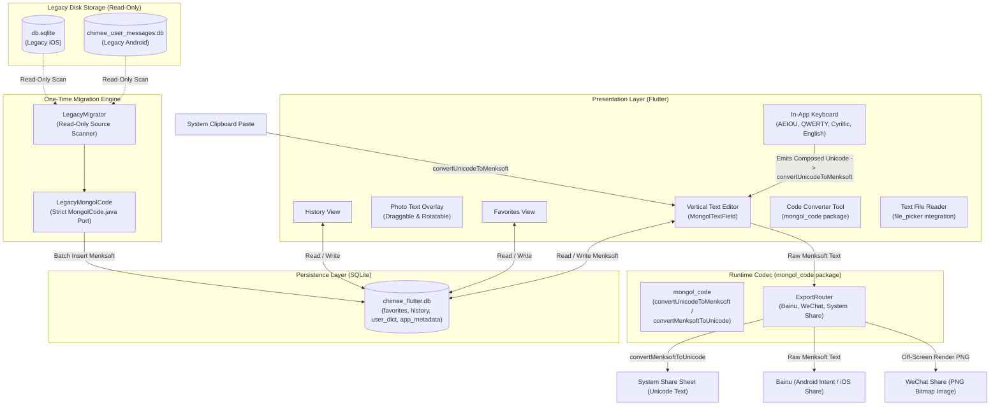
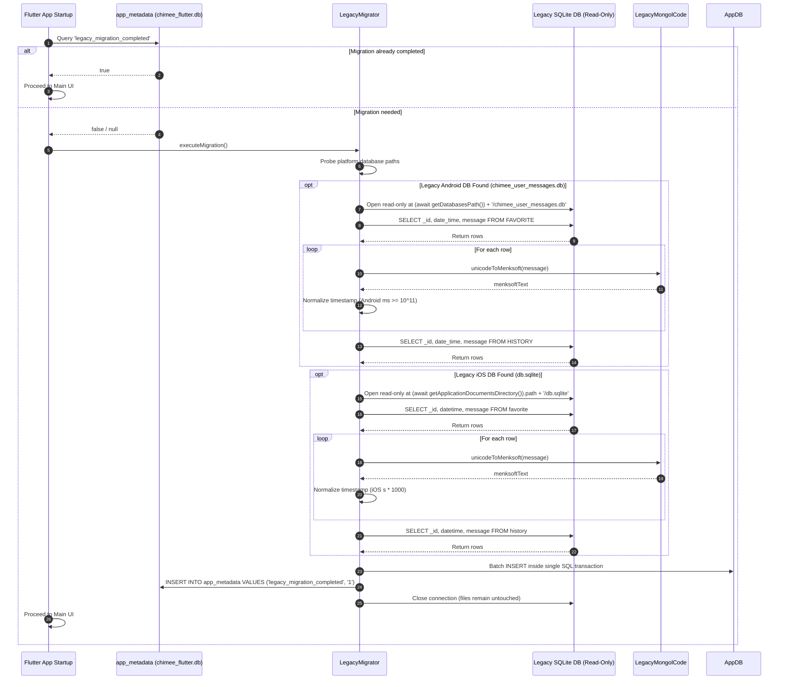

# Technical Design Document: Chimee Flutter Port

* **Author:** suragch
* **Date:** 2026-11-03
* **Status:** Finalized (Remediated)

---

## 1. The Problem

Chimee provides Traditional Mongolian vertical text editing and keyboard input on Android and iOS. Maintaining two separate native codebases (Java on Android, Swift on iOS) duplicates maintenance effort and slows down updates. 

However, porting the application to a unified Flutter codebase presents several specific problems:
1. **Shifting Rendering Standards in Unicode Mongolian**: Traditional Mongolian Unicode relies on context and Free Variation Selectors (FVS1–FVS3) to select letter forms. Because font makers and operating system text engines have implemented conflicting interpretations of the Unicode standard over time, text encoded in Unicode displays inconsistently across OS releases. In contrast, Menksoft code uses explicit Private Use Area (PUA) code points that map 1-to-1 with font glyphs, providing visual stability.
2. **Data Preservation on Upgrade**: Existing users on Android and iOS have accumulated messages, favorites, and history in local SQLite databases (`chimee_user_messages.db` on Android and `db.sqlite` on iOS). A migration that alters or replaces these databases risks unrecoverable text corruption or loss if the app update is interrupted or encounters unsupported character sequences.
3. **OS System Keyboard Limitations**: In earlier versions, Android Chimee attempted to maintain a system-level input method service (`InputMethodService`). However, running a Flutter engine inside an OS system keyboard causes high memory overhead (~50–90 MB) and cold-start latency. Furthermore, sharing a Menksoft-encoded database between a Flutter app and an OS system keyboard creates a fatal encoding mismatch: external apps (Chrome, WeChat, SMS) require standard Unicode Mongolian (`0x1800`–`0x18AF`), while the vertical editor requires Menksoft PUA code (`0xE264`–`0xE3FF`). Retiring the OS system keyboard in favor of an in-app keyboard eliminates cross-process database contention, memory spikes, and character encoding conflicts.
4. **Platform-Specific Interoperability**: External apps in the Mongolian mobile ecosystem expect different encodings. Bainu requires Menksoft code, whereas WeChat, SMS, and standard text sharing require standard Unicode (or rendered image cards).

---

## 2. Overview

This project ports Chimee to a pure Flutter application located in `/Users/suragch/Dev/FlutterProjects/chimee`. The existing repositories serve strictly as read-only references:
- **Legacy Android App**: `/Users/suragch/Dev/AndroidProjects/Chimee`
- **Legacy iOS App**: `/Users/suragch/Dev/AndroidProjects/Chimee-iOS`
- **Legacy Android Library**: `/Users/suragch/Dev/AndroidProjects/mongol-library`
- **Flutter Vertical Layout Library**: `/Users/suragch/Dev/FlutterProjects/mongol`
- **Flutter Codec Library**: `/Users/suragch/Dev/DartProjects/mongol_code`

The core approach consists of:
- **Unified Standalone Application**: A Flutter application providing the vertical text editor, in-app keyboard, photo text overlay card creator, message history, favorites, text file reader, and code converter. Text layout is handled by the `mongol` package from pub.dev.
- **In-App Keyboard Exclusivity**: The custom Mongolian keyboard is scoped strictly to the in-app experience across all platforms, providing consistent behavior on Android and iOS without background OS service complexity.
- **Stable Persistence via Menksoft Encoding**: Storing and rendering text in Menksoft code in a new, single-process SQLite database (`chimee_flutter.db`), isolating stored user text from external Unicode standard shifts.
- **Non-Destructive Migration**: Ingesting legacy Android (`chimee_user_messages.db`) and iOS (`db.sqlite`) databases in a read-only transaction on first startup, converting historical records to Menksoft code via a standalone `LegacyMongolCode` converter validated against `legacy_code_test.dart`, and leaving legacy database files unmodified.
- **Boundary Encoding Gateways**: Converting pasted Unicode text to Menksoft code on the fly in the editor via `mongol_code`, and dispatching outgoing shares as Unicode for standard apps, unconstrained off-screen image cards for WeChat, and Menksoft code for Bainu.

---

## 3. Goals & Non-Goals

### Goals
- Deliver full feature parity with legacy Android and iOS apps in a cross-platform Flutter application (vertical text editor, in-app keyboard, photo card overlay tool, message history, favorites, text file reader, and code converter).
- Deliver a responsive in-app Mongolian keyboard in Flutter with AEIOU, QWERTY transliteration, Cyrillic, and English layouts.
- Isolate stored text from Unicode rendering shifts by persisting Menksoft code in `chimee_flutter.db`.
- Safely migrate legacy Android and iOS SQLite records into `chimee_flutter.db` without altering or deleting the original database files.
- Validate the Dart `LegacyMongolCode` converter against the 9,136-line test suite in `legacy_code_test.dart` prior to running migration.
- Automatically detect and convert pasted Unicode Mongolian text into Menksoft code using `mongol_code`.
- Support destination-specific sharing (Unicode text for system shares, Menksoft code for Bainu, and unconstrained bitmap card rendering for WeChat).
- Provide multi-touch gesture disambiguation separating single-finger text scrolling from two-finger pinch scaling (editor container height and font size).

### Non-Goals
- Operating system system keyboard extensions or background services on Android (`InputMethodService`) or iOS (`UIInputViewController` / `NSExtension`). The keyboard is strictly in-app.
- In-place modification, deletion, or schema changes to legacy database files (`chimee_user_messages.db` and `db.sqlite`).
- Migrating legacy learned dictionaries (`chimee_user_dict.db` on Android or table `words` on iOS). The in-app dictionary uses a clean, pre-seeded bundled wordlist and auto-learns newly committed words.
- Complex n-gram predictive typing models; the in-app candidate bar provides prefix matching against `user_dictionary`.
- Adding cloud sync, user accounts, or external network backup services in the initial release.
- Modifying the external `mongol` library source code.

---

## 4. Technical Plan

### 4.1 System Architecture

The application is structured into four primary layers:
1. **Presentation Layer (Flutter)**: UI views and controllers built using widgets from the `mongol` package (`MongolTextField`, `MongolText`).
2. **Core & Codec Layer**:
   - **Modern Runtime Codec (`mongol_code` package)**: Standard Dart package used for all runtime conversions throughout the app lifecycle, including live clipboard paste ingestion, text export conversion (Menksoft to Unicode), and the interactive two-way code converter screen.
   - **One-Time Historical Migration Engine (`LegacyMongolCode`)**: Isolated Dart port of the original Android `MongolCode.java` algorithm, executed strictly during the one-time legacy database migration to ensure historical Unicode is transformed to Menksoft code without modern Unicode standard divergence.
   - **Export Router (`ExportRouter`)**: Packages destination-specific payloads for Bainu, WeChat, and system share sheets.
3. **Data Layer**: Single-process SQLite storage via `sqflite` targeting `chimee_flutter.db`, accompanied by a read-only `LegacyMigrator`.
4. **Platform Host Layer**: Standard Flutter runner on Android and iOS configuring photo library permissions and file viewing intent filters.



---

### 4.2 Database Schema (`chimee_flutter.db`)

The persistent database is managed via `sqflite` strictly within the Flutter application process:

```sql
-- Favorites table
CREATE TABLE favorites (
    id INTEGER PRIMARY KEY AUTOINCREMENT,
    legacy_source TEXT,          -- 'android', 'ios', or NULL for new entries
    legacy_id INTEGER,           -- Original row ID from legacy database
    timestamp INTEGER NOT NULL,  -- Unix epoch in milliseconds
    message TEXT NOT NULL        -- Stored in Menksoft code
);

-- History table
CREATE TABLE history (
    id INTEGER PRIMARY KEY AUTOINCREMENT,
    legacy_source TEXT,
    legacy_id INTEGER,
    timestamp INTEGER NOT NULL,  -- Unix epoch in milliseconds
    message TEXT NOT NULL        -- Stored in Menksoft code
);

-- User Dictionary (predictive text candidates for in-app keyboard)
CREATE TABLE user_dictionary (
    id INTEGER PRIMARY KEY AUTOINCREMENT,
    word TEXT NOT NULL UNIQUE,   -- Stored in Menksoft code
    frequency INTEGER NOT NULL DEFAULT 1
);

-- Metadata & Migration state table (single source of truth for migration)
CREATE TABLE app_metadata (
    key TEXT PRIMARY KEY,
    value TEXT NOT NULL
);
```

---

### 4.3 Legacy Database Migration Workflow

Migration executes on the initial application launch following an update. The workflow ensures zero data loss and safe recovery if interrupted.



#### Migration Integrity Constraints
1. **Read-Only Access**: Legacy database files are opened strictly in read-only mode (`readOnly: true`). No `DROP`, `ALTER`, or `DELETE` statements are ever executed against legacy files.
2. **Platform Schema Handling**:
   - Android queries: `SELECT _id, date_time, message FROM FAVORITE` and `SELECT _id, date_time, message FROM HISTORY`.
   - iOS queries: `SELECT _id, datetime, message FROM favorite` and `SELECT _id, datetime, message FROM history`.
3. **Timestamp Normalization**:
   $$\text{timestamp\_ms} = \begin{cases} \text{raw} & \text{if } \text{raw} \ge 10^{11} \text{ (Android millisecond timestamps)} \\ \text{raw} \times 1000 & \text{if } \text{raw} < 10^{11} \text{ (iOS second timestamps)} \end{cases}$$
4. **Transaction Boundary & Single Source of Truth**: All migrated rows and the `legacy_migration_completed = 1` record commit within a single atomic SQLite transaction in `app_metadata`. If interrupted, the transaction rolls back cleanly and safely retries on the next startup.

---

### 4.4 In-App Keyboard & Editing Pipeline

The in-app keyboard is implemented as a set of Flutter widgets that render below or inside the main editor view:
1. **Layout Configurations**:
   - **AEIOU Keyboard**: Traditional Mongolian phonetic layout presenting vowels, root consonants, and Free Variation Selectors (FVS1–FVS3).
   - **QWERTY Layout**: Latin phonetic transliteration mapping to Mongolian characters.
   - **Cyrillic Layout**: Standard Mongolian Cyrillic layout.
   - **English Layout**: Standard Latin alphanumeric keyboard.
2. **Keystroke Processing & Shaping**:
   - Keyboard keys emit Unicode characters into a composing word buffer. Word shaping (calculating isolate, initial, medial, and final forms) is delegated directly to `mongol_code.convertUnicodeToMenksoft()` at word boundaries or key commit, avoiding redundant shaping logic in UI widgets.
3. **Gesture Disambiguation**:
   - Multi-touch arbitration in `scale_gesture_container.dart` isolates touches:
     - 1-pointer touches route strictly to vertical and horizontal scroll view physics.
     - 2-pointer touches route strictly to pinch-scaling for font size (horizontal spread) and editor container height (vertical spread).
4. **Candidate Bar & Dictionary Population**:
   - Positioned horizontally above the keyboard. Queries `user_dictionary` for words beginning with the current prefix, ordered by `frequency DESC`.
   - On fresh installation, `user_dictionary` is pre-seeded with a bundled asset wordlist (`assets/dictionary/mongol_words.txt`).
   - Words committed in the editor are automatically learned into `user_dictionary` with frequency increments.

---

### 4.5 Clipboard Ingestion

When text is pasted from the OS clipboard into the editor:
- The string is passed directly to `mongol_code.convertUnicodeToMenksoft()`.
- `mongol_code` converts Unicode Mongolian segments (`0x1800`–`0x18AF`) into Menksoft PUA code points while transparently passing through non-Mongolian characters (Latin, CJK, numbers, emoji, punctuation) and pre-existing Menksoft PUA code points (`0xE264`–`0xE3FF`) unaltered.

---

### 4.6 Target-Specific Export Router

Outgoing text sharing follows destination-specific routing:
- **Bainu Target (`com.zuga.im`)**:
  - Payload: Raw Menksoft code string.
  - Android: `Intent(Intent.ACTION_SEND)` targeted to component `com.zuga.im/com.zuga.im.bainuSdk.BNEntryActivity` with MIME type `text/plain`.
  - iOS / Fallback: Standard system activity sheet (`Share.share(menksoftText)`).
- **WeChat Target (`com.tencent.mm`)**:
  - Payload: Rendered vertical text image (PNG).
  - To prevent viewport clipping on long horizontally scrolling text, the export router renders the complete text off-screen using an unconstrained layout (`MongolTextPainter` or off-screen widget tree sized to full scroll dimensions) and captures the complete image buffer to PNG.
- **System Share / Generic Apps**:
  - Payload: Standard Unicode string.
  - Converts Menksoft text to Unicode via `mongol_code.convertMenksoftToUnicode()` and invokes `Share.share(unicodeText)`.

---

## 5. Alternatives Considered

### 5.1 Retaining the Android System Keyboard (`InputMethodService`)
- **Description**: Keeping the native Java `ChimeeInputMethodService` in `android/` alongside the Flutter application.
- **Reason for Rejection**: The native system IME must emit standard Unicode Mongolian into third-party apps (WeChat, Chrome, SMS). In contrast, the Flutter vertical editor requires Menksoft PUA code. Sharing `chimee_flutter.db` between both subsystems creates a fatal encoding mismatch where candidate lookups fail and PUA glyphs leak into external apps. Furthermore, multi-process SQLite access introduces WAL lock contention and cold-start crashes. Scoping the keyboard to an in-app experience provides 100% cross-platform parity on Android and iOS with clean process isolation.

### 5.2 Building an iOS System Keyboard Extension in Flutter
- **Description**: Packaging the Flutter in-app keyboard as an iOS `UIInputViewController` inside an `NSExtension` bundle for system-wide typing on iOS devices.
- **Reason for Rejection**: iOS strictly terminates keyboard extensions that exceed roughly 30 MB of RAM. The Flutter engine, Dart VM, and base asset bundle consume 35–50 MB upon initialization alone, causing Apple's memory watchdog (`jetsam`) to crash the process immediately. Furthermore, historical inspection of `Chimee-iOS` confirmed that the legacy iOS app never had a system keyboard extension; it only contained an in-app keyboard.

### 5.3 Storing Persistent Text in Canonical Unicode
- **Description**: Storing all message history and favorites in Unicode (`U+1800`–`U+18AF`) inside SQLite and converting to Menksoft code dynamically on each rendering frame.
- **Reason for Rejection**: Traditional Mongolian Unicode shaping rules and font implementations vary across operating systems, vendors, and specification revisions. Storing raw Unicode leaves user records vulnerable to display inconsistencies when system text engines or fonts change. In contrast, Menksoft code uses explicit Private Use Area (PUA) code points that map deterministically to font glyphs in Menksoft-encoded typefaces. Converting to Unicode at export boundaries maintains compatibility while keeping local data stable.

### 5.4 In-Place Legacy SQLite Migration
- **Description**: Altering the legacy SQLite database files directly (`chimee_user_messages.db` on Android and `db.sqlite` on iOS) by adding columns or converting text in place.
- **Reason for Rejection**: In-place modification exposes user records to unrecoverable corruption if the migration process is interrupted by device shutdown, battery depletion, or an unexpected character exception. Creating an isolated target database (`chimee_flutter.db`) and reading legacy databases in read-only mode ensures the original user records remain completely intact as an immutable recovery fallback.

### 5.5 Using the Modern `mongol_code` Package for Legacy Migration
- **Description**: Running the latest release of `mongol_code` to convert historical Unicode records to Menksoft code during database migration.
- **Reason for Rejection**: The modern `mongol_code` library incorporates recent updates to Mongolian Unicode specifications that diverge from the Unicode 10.0 and DS01 (Drafting Standard 01 / Mongolian Unicode Working Group document N4949) deviation rules implemented in the legacy Android `MongolCode.java` (specifically regarding medial I and final GA context rules). Applying modern rules to historical text can alter the visual letter forms originally saved by the user. Porting the exact historical Java algorithm into an isolated `LegacyMongolCode` class guarantees faithful conversion of historical records.

---

## 6. Detailed Implementation Plan

The implementation is executed across five sequential phases. All file references are relative to the project root `/Users/suragch/Dev/FlutterProjects/chimee`.

### Phase 1: Project Scaffolding, Font Assets & Codec Porting
1. Initialize Flutter project: `flutter create --org net.studymongolian . --platforms=android,ios`.
   - Note: If `android/app/src/main/kotlin/.../MainActivity.kt` is generated, delete it or pass `--android-language java` to prevent duplicate class conflicts.
2. Configure project dependencies in `pubspec.yaml`:
   - Dependencies: `mongol: ^11.2.0`, `mongol_code: ^0.4.0`, `sqflite: ^2.3.0`, `path_provider: ^2.1.0`, `path: ^1.9.0`, `share_plus: ^10.0.0`, `image_picker: ^1.1.0`, `file_picker: ^8.0.0`, `shared_preferences: ^2.2.0`.
   - Dev Dependencies: `flutter_test`, `flutter_lints`, `sqflite_common_ffi: ^2.3.0`.
3. Register bundled Menksoft fonts under `flutter: fonts:` in `pubspec.yaml` (fonts copied into `assets/fonts/`):
   - `Qagan` (`MQG8F02.ttf`)
   - `ChimeeWhite` (`ChimeeWhiteMirrored.ttf`)
   - Auxiliary Menksoft typefaces (`MAM8102.ttf`, `MBJ8102.ttf`, `MBN8102.ttf`, `MER8102.ttf`, `MGQ8102.ttf`, `MHL8102.ttf`, `MHR8102.ttf`, `MHW8102.ttf`, `MMB8102.ttf`, `MNR8102.ttf`, `MQD8102.ttf`, `MQI8102.ttf`, `MQM8102.ttf`, `MSN8102.ttf`, `MSO8102.ttf`, `MTH8102.ttf`, `MTR8102.ttf`, `MVY8102.ttf`, `MWJ8102.ttf`, `MenksoftJclgq.ttf`).
4. Move `legacy_code_test.dart` to `test/legacy_code_test.dart` and update its imports from `package:mongol_code/...` to `package:chimee/core/codec/legacy_mongol_code.dart`, instantiating `LegacyMongolCode()`.
5. Port `LegacyMongolCode` to Dart in `lib/core/codec/legacy_mongol_code.dart` matching `/Users/suragch/Dev/AndroidProjects/mongol-library/mongol-library/src/main/java/net/studymongolian/mongollibrary/MongolCode.java` line-for-line.
6. Run `flutter test test/legacy_code_test.dart` until all 9,136 lines and 150+ test groups pass 100% green.

### Phase 2: Database Layer & Legacy Migration Engine
1. Implement `AppDatabase` managing `chimee_flutter.db` with single-process SQLite access.
2. Define entity models for `FavoriteItem`, `HistoryItem`, and `DictionaryWord`.
3. Implement `LegacyMigrator`:
   - Detect legacy Android SQLite DB at `(await getDatabasesPath()) + '/chimee_user_messages.db'`.
   - Detect legacy iOS SQLite DB at `(await getApplicationDocumentsDirectory()).path + '/db.sqlite'`.
   - Execute platform-specific queries:
     - Android: `SELECT _id, date_time, message FROM FAVORITE` / `HISTORY`.
     - iOS: `SELECT _id, datetime, message FROM favorite` / `history`.
   - Normalize timestamps: values $< 10^{11}$ multiplied by 1000 (iOS seconds to ms).
   - Batch-convert historical Unicode text to Menksoft code using `LegacyMongolCode`.
   - Commit all rows and set `legacy_migration_completed = 1` in `app_metadata` inside a single atomic transaction.
4. Implement `test/legacy_migrator_test.dart` initializing `sqflite_common_ffi` (`sqfliteFfiInit()`, `databaseFactory = databaseFactoryFfi`) to validate migration on desktop test environments.

### Phase 3: Text Pipeline & Target-Specific Export
1. Integrate clipboard paste interceptor in editor controller calling `mongol_code.convertUnicodeToMenksoft()`.
2. Implement `ExportRouter` in `lib/features/sharing/export_router.dart`:
   - Bainu route: direct intent with raw Menksoft text on Android (`com.zuga.im/...`), system share on iOS.
   - WeChat route: unconstrained off-screen render to PNG via `MongolTextPainter` or off-screen render boundary to prevent horizontal clipping.
   - Generic route: convert Menksoft text to Unicode via `mongol_code.convertMenksoftToUnicode()` and dispatch system share.
3. Create `test/export_router_test.dart` validating outgoing payloads for all share routes.

### Phase 4: Core User Interface & In-App Keyboard
1. Build `EditorScreen` in `lib/features/editor/editor_screen.dart` wrapping `MongolTextField` from `mongol`.
2. Implement `scale_gesture_container.dart` with multi-touch routing (1 pointer = scroll, 2+ pointers = pinch-to-scale font size and editor container height).
3. Build `InAppKeyboard` in `lib/features/keyboard/in_app_keyboard.dart`:
   - Layouts: AEIOU (`aeiou_layout.dart`), QWERTY (`qwerty_layout.dart`), Cyrillic (`cyrillic_layout.dart`), English (`english_layout.dart`).
   - Keys emit Unicode into buffer, delegating word shaping to `mongol_code.convertUnicodeToMenksoft()`.
   - Candidate suggestion bar (`candidate_bar.dart`) querying `user_dictionary`.
   - Seed `user_dictionary` on first boot from `assets/dictionary/mongol_words.txt`, and auto-learn committed words.
4. Build ancillary screens:
   - `FavoritesScreen`: List view with tap-to-insert, edit, and delete.
   - `HistoryScreen`: Chronological list view with search and delete.
   - `PhotoOverlayScreen`: Draggable, rotatable, scalable vertical text banner over gallery photos.
   - `CodeConverterScreen`: Two-way interactive Unicode <-> Menksoft text converter using modern `mongol_code`.
   - `ReaderScreen`: Vertical reader for `.txt` files with `file_picker` integration.
   - `SettingsScreen`: Font family chooser, default text size, color scheme preferences.
   - `AboutScreen`: App version, Menksoft font copyright notices, and open-source licenses.

### Phase 5: Platform Configuration & Verification
1. Configure `android/app/build.gradle` and `android/app/src/main/AndroidManifest.xml`:
   - Application ID: `net.studymongolian.chimee`.
   - Target SDK 35, Min SDK 21.
   - FileProvider authorities for photo and card sharing.
2. Configure `ios/Runner/Info.plist`:
   - `NSPhotoLibraryUsageDescription` for photo overlay image selection.
   - `NSPhotoLibraryAddUsageDescription` for saving generated cards to gallery.
3. Run comprehensive test suite:
   - `flutter test test/legacy_code_test.dart`
   - `flutter test test/legacy_migrator_test.dart`
   - `flutter test test/export_router_test.dart`

---

### 6.1 Complete File Manifest

| File Path                                                               |       Action       | Rationale                                                                                                                       |
| :---------------------------------------------------------------------- | :----------------: | :------------------------------------------------------------------------------------------------------------------------------ |
| `pubspec.yaml`                                                          | Create / Configure | Defines package metadata, fonts, asset directories, and dependencies (`mongol`, `mongol_code`, `sqflite`, `file_picker`, etc.). |
| `assets/fonts/*.ttf`                                                    |  Copy / Register   | 22 bundled Menksoft TTF fonts providing deterministic visual glyphs for PUA code points `0xE264`–`0xE3FF`.                      |
| `assets/dictionary/mongol_words.txt`                                    |       Create       | Initial static vocabulary seed list for the in-app candidate suggestion bar.                                                    |
| `test/legacy_code_test.dart`                                            |   Move / Update    | 9,136-line regression test suite updated to test `LegacyMongolCode`.                                                            |
| `lib/main.dart`                                                         |       Create       | Application entry point; initializes database, triggers legacy migration check, and boots root widget.                          |
| `lib/core/codec/legacy_mongol_code.dart`                                |       Create       | Isolated Dart port of `MongolCode.java` used strictly for one-time legacy database migration.                                   |
| `lib/core/database/app_database.dart`                                   |       Create       | Initializes and provides access to `chimee_flutter.db` for single-process app storage.                                          |
| `lib/core/database/database_constants.dart`                             |       Create       | Centralizes table names (`favorites`, `history`, `user_dictionary`, `app_metadata`) and column schemas.                         |
| `lib/core/database/legacy_migrator.dart`                                |       Create       | Discovers legacy Android and iOS databases, reads them in read-only mode, and converts records to Menksoft code.                |
| `lib/core/database/models/favorite_item.dart`                           |       Create       | Data model representing a saved favorite record.                                                                                |
| `lib/core/database/models/history_item.dart`                            |       Create       | Data model representing a message history record.                                                                               |
| `lib/core/database/models/dictionary_word.dart`                         |       Create       | Data model representing a predictive vocabulary word and its usage frequency.                                                   |
| `lib/core/theme/app_theme.dart`                                         |       Create       | Provides global application styling, color palettes, and standard text styles.                                                  |
| `lib/core/theme/mongol_fonts.dart`                                      |       Create       | Font family definitions and Menksoft typeface asset mappings (Qagan, Garqag, ChimeeWhite, etc.).                                |
| `lib/features/editor/editor_controller.dart`                            |       Create       | Manages editor text buffer, selection, undo history, and clipboard paste conversion via `mongol_code`.                          |
| `lib/features/editor/editor_screen.dart`                                |       Create       | Main workspace combining vertical text editor (`MongolTextField`), toolbar, and in-app keyboard container.                      |
| `lib/features/editor/widgets/scale_gesture_container.dart`              |       Create       | Multi-touch recognizer routing 1 pointer to scroll physics and 2+ pointers to pinch scaling.                                    |
| `lib/features/editor/widgets/editor_toolbar.dart`                       |       Create       | Top bar actions: share, photo overlay, favorites toggle, clear, and overflow menu button.                                       |
| `lib/features/editor/widgets/overflow_menu.dart`                        |       Create       | Popup menu containing Open, Save, Settings, Code Converter, and Reader options.                                                 |
| `lib/features/keyboard/in_app_keyboard.dart`                            |       Create       | Virtual keyboard coordinator hosting candidate strip, layout switchers, and key emission handlers.                              |
| `lib/features/keyboard/keyboard_state.dart`                             |       Create       | State notifier tracking active keyboard mode (AEIOU, QWERTY, Cyrillic, English) and shift state.                                |
| `lib/features/keyboard/candidate_bar.dart`                              |       Create       | Horizontal sliding candidate bar presenting predictive completions from `user_dictionary`.                                      |
| `lib/features/keyboard/layouts/aeiou_layout.dart`                       |       Create       | Mongolian vowel-first layout with primary consonants and variation selector popups.                                             |
| `lib/features/keyboard/layouts/qwerty_layout.dart`                      |       Create       | Latin phonetic transliteration layout for Mongolian input.                                                                      |
| `lib/features/keyboard/layouts/cyrillic_layout.dart`                    |       Create       | Cyrillic layout for Mongolian Cyrillic text entry.                                                                              |
| `lib/features/keyboard/layouts/english_layout.dart`                     |       Create       | Standard alphanumeric Latin keyboard layout.                                                                                    |
| `lib/features/keyboard/widgets/keyboard_key_button.dart`                |       Create       | Reusable key widget supporting tap animations, haptic feedback, and long-press popup triggers.                                  |
| `lib/features/keyboard/widgets/key_popup.dart`                          |       Create       | Contextual popup showing variant letter forms and FVS options above long-pressed keys.                                          |
| `lib/features/favorites/favorites_screen.dart`                          |       Create       | Vertical list of favorite messages with insert-into-editor, edit, and swipe-to-delete actions.                                  |
| `lib/features/favorites/add_edit_favorite_dialog.dart`                  |       Create       | Dialog allowing manual addition or editing of saved favorite messages.                                                          |
| `lib/features/history/history_screen.dart`                              |       Create       | Chronological list of previously sent or saved messages with tap-to-insert and clear-all actions.                               |
| `lib/features/photo_overlay/photo_overlay_screen.dart`                  |       Create       | Photo canvas view allowing users to select background pictures and position vertical Mongolian text banners.                    |
| `lib/features/photo_overlay/widgets/draggable_text_banner.dart`         |       Create       | Interactive text banner supporting dragging, rotation, font scaling, and color adjustments.                                     |
| `lib/features/converter/converter_screen.dart`                          |       Create       | Live two-way conversion tool translating text between Unicode Mongolian and Menksoft code via `mongol_code`.                    |
| `lib/features/converter/converter_details_screen.dart`                  |       Create       | Visual inspection tool displaying individual glyph mappings and underlying character code points.                               |
| `lib/features/reader/reader_screen.dart`                                |       Create       | Fullscreen vertical text viewer for opening and reading `.txt` files selected via `file_picker`.                                |
| `lib/features/settings/settings_screen.dart`                            |       Create       | Settings menu for customizing font family, text sizes, and background colors.                                                   |
| `lib/features/settings/about_screen.dart`                               |       Create       | Displays app version, license information, and font copyright notices.                                                          |
| `lib/features/sharing/export_router.dart`                               |       Create       | Routes outgoing payloads: Menksoft to Bainu, off-screen unconstrained PNG image to WeChat, and Unicode text to system share.    |
| `android/app/build.gradle`                                              |     Configure      | Configures Android compile/target SDK versions, application ID `net.studymongolian.chimee`.                                     |
| `android/app/src/main/AndroidManifest.xml`                              |     Configure      | Registers `MainActivity`, `FileProvider`, permissions for media/storage.                                                        |
| `android/app/src/main/java/net/studymongolian/chimee/MainActivity.java` | Create / Configure | Standard `FlutterActivity` host without system IME service declarations.                                                        |
| `android/app/src/main/res/xml/filepaths.xml`                            |     Configure      | FileProvider sharing paths for exported image cards.                                                                            |
| `ios/Runner/Info.plist`                                                 |     Configure      | Configures `NSPhotoLibraryUsageDescription` and `NSPhotoLibraryAddUsageDescription`.                                            |
| `test/legacy_migrator_test.dart`                                        |       Create       | Unit test validating read-only migration and timestamp normalization using `sqflite_common_ffi`.                                |
| `test/export_router_test.dart`                                          |       Create       | Unit test verifying correct payload formatting for Bainu, WeChat, and system share targets.                                     |
